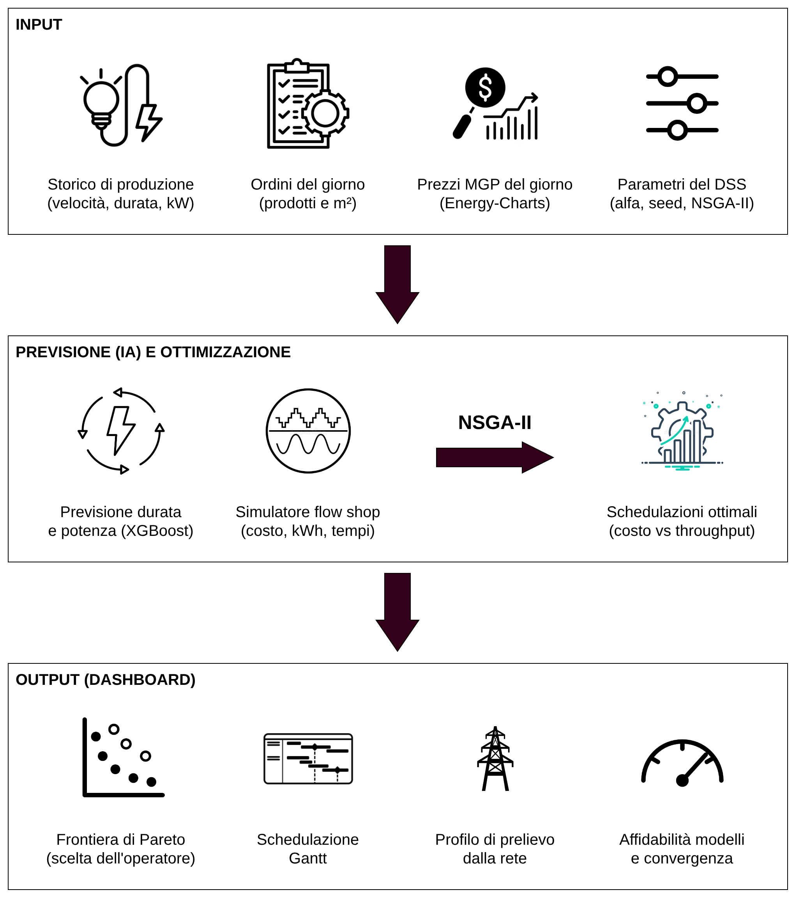

# DSS Flow Shop · Pagina di presentazione

**Decision Support System per la schedulazione energy-aware di un flow shop a quattro macchine**

Progetto finale del Corso di Perfezionamento in Tecnologie Digitali per Ambienti e Sistemi Intelligenti, Università del Salento (a.a. 2025/2026).
Autore: Claudio Mammino

**Pagina pubblicata:** https://unisalento-idalab-corsoperfez-25-26.github.io/perfez-2526-presentation-Mammino/

---

## Il progetto

**DSS Flow Shop** è un prototipo (Proof of Concept) di sistema di supporto alle decisioni che, per la giornata di produzione di un reparto con quattro macchine in serie, propone più programmi alternativi agendo su sequenza degli ordini, velocità di ogni ordine su ogni macchina e pause facoltative.

Gli obiettivi sono due e in conflitto, **minimizzare il costo energetico** con i prezzi orari reali del Mercato del Giorno Prima e **massimizzare il throughput**. I vincoli sono il completamento entro 24 ore e un throughput minimo rispetto alla prassi attuale. Il sistema restituisce la frontiera di Pareto delle soluzioni non dominate; la scelta finale resta all'operatore.

Due modelli **XGBoost** stimano durata e potenza di ogni lavorazione a partire dallo storico di produzione; **NSGA-II** (pymoo) cerca le soluzioni non dominate; i prezzi sono scaricati da Energy-Charts (Fraunhofer ISE).

## Architettura



| Blocco | Contenuto |
|---|---|
| **Input** | Storico di produzione, ordini del giorno, prezzi MGP del giorno, parametri del DSS |
| **Previsione e ottimizzazione** | Modelli XGBoost per durata e potenza; simulatore del flow shop; NSGA-II |
| **Output** | Dashboard web: frontiera di Pareto, Gantt, profilo di prelievo, affidabilità dei modelli e convergenza |

## Repository del progetto

| Repository | Contenuto |
|---|---|
| [perfez-2526-DSSFlowShop-Mammino](https://github.com/UniSalento-IDALab-corsoPerfez-25-26/perfez-2526-DSSFlowShop-Mammino) | L'intero sistema: backend FastAPI, modelli, ottimizzatore e dashboard. Installazione e avvio nel suo README |
| [perfez-2526-presentation-Mammino](https://github.com/UniSalento-IDALab-corsoPerfez-25-26/perfez-2526-presentation-Mammino) | Questo repository: la pagina di presentazione |

## Questo repository: la pagina di presentazione

Pagina web statica pubblicata con GitHub Pages, che descrive problema, architettura, funzionamento, risultati, limiti e sviluppi del progetto.

```
├── index.html     La pagina (HTML e CSS in un unico file)
├── assets/        Figure: architettura, flow shop, prezzi, frontiera di Pareto, profilo energetico, affidabilità, convergenza, robustezza
└── README.md
```

Per vederla in locale basta aprire `index.html` nel browser. La pubblicazione è attiva da *Settings → Pages*, sorgente: branch `main`, cartella `/ (root)`.
